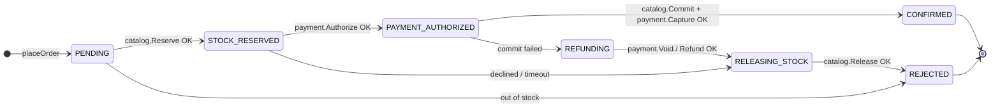

# Design: multitenant order and payments platform

Rework of the original gRPC + GraphQL demo (kept as tag `v0-legacy`) into a small but correct
commerce backend: **place order → reserve stock → take payment → confirm**, with compensation when
any step fails, exact money, a double-entry ledger, idempotency everywhere, and tenants that cannot
see each other's data.

## 1. Requirements

| # | Requirement | How it is met |
|---|---|---|
| F1 | A customer places an order for products of one tenant | `order` service, GraphQL `placeOrder` |
| F2 | Stock is reserved before payment and never oversold | conditional `UPDATE ... WHERE available >= qty` in `catalog` |
| F3 | Payment is authorised, then captured on confirmation; refunded if a later step fails | `payment` service, payment intents |
| F4 | Every money movement is recorded twice (debit = credit) and balances are derivable | double-entry ledger, invariant enforced in the database |
| F5 | Retried or duplicated requests have no extra effect | idempotency keys on every write, unique constraints |
| F6 | Card processor webhooks are authentic, fresh and processed once | HMAC-SHA256 signature, 5-minute timestamp window, replay table |
| F7 | Ledger and processor agree every day | reconciliation job against the processor's settlement statement |
| F8 | Tenants are isolated | tenant id from the JWT, propagated over gRPC, enforced by Postgres row-level security |
| N1 | No lost or double events between services | transactional outbox + idempotent consumers |
| N2 | Every request is traceable across services | OpenTelemetry → Jaeger; logs carry trace id and tenant id |
| N3 | Runs on a 16 GB laptop | one Postgres, one Redpanda, Go binaries (~20 MB RSS each) |

## 2. Services

| Service | Owns (own database) | Talks to |
|---|---|---|
| `gateway` | — | GraphQL in; gRPC to all services; verifies JWT |
| `account` | tenants, users, customers | — |
| `catalog` | products, prices, stock, reservations | — |
| `order` | orders, order lines, **saga state**, outbox | catalog, payment (gRPC); Redpanda (events) |
| `payment` | ledger accounts, journal entries, payment intents, webhook inbox, outbox | fakepsp (HTTP); Redpanda |
| `fakepsp` | its own charges and statements | sends signed webhooks to `payment` |

All services are Go 1.27, gRPC with protobuf (`proto/<svc>/v1`), one Go module.

## 3. Key decisions

| Decision | Chosen | Instead of | Why |
|---|---|---|---|
| Storage | **PostgreSQL 17 for every service** (database per service) | Cassandra (orders), Elasticsearch (catalog) | Ledger, outbox and saga state need transactions; RLS gives tenancy; FTS is enough for catalog search; ~2 GB less RAM |
| Money | `int64` minor units + ISO currency | `float64` | Floats can't represent 0.10; sums drift |
| Saga style | **Orchestration** in `order` (persisted state machine) | Choreography over events | One place to read the flow, test it and see where an order is stuck |
| Step calls | gRPC with idempotency key `order:<id>:<step>` | Commands over Kafka | Simpler request/response for steps; durability comes from the saga table + recovery loop |
| Events | Redpanda (Kafka API), transactional outbox, at-least-once | Direct publish after commit | Publish-after-commit loses events on crash |
| Tenancy | Shared schema, `tenant_id` column + **RLS**, services connect as a non-owner role | Schema per tenant | One migration path; RLS makes a missing `WHERE tenant_id` harmless |
| Search | Postgres full-text (`tsvector` + GIN) | Elasticsearch 6 | Same features needed here at a fraction of the cost |
| GraphQL | gqlgen (current) | gqlgen 0.10 (2019) | Upgrade; schema-first stays |

## 4. Order saga



Each transition is written to `order.sagas` in the same transaction as an outbox event. A recovery loop
picks up sagas that have not moved for N seconds and retries the current step; every step call is
idempotent, so retrying is always safe.

## 5. Ledger

- `ledger.accounts(id, tenant_id, code, currency, kind)`: e.g. `customer_receivable`, `psp_clearing`, `merchant_payable`, `fees`.
- `ledger.entries(id, tenant_id, idempotency_key UNIQUE, kind, created_at)` and
  `ledger.postings(entry_id, account_id, amount_minor BIGINT, currency)`: positive = debit, negative = credit.
- **Invariant:** for every entry, postings sum to 0 per currency. Enforced by a deferred constraint
  trigger, so a transaction that writes an unbalanced entry fails at COMMIT.
- Balances are `SUM(amount_minor)` per account (plus a cached balance updated in the same transaction).

## 6. Tenancy

```
JWT (tid, sub) ──► gateway ──gRPC metadata x-tenant-id──► service interceptor ──► ctx
                                                                │
          db.InTenantTx(ctx): BEGIN; SET LOCAL app.tenant_id = $1; ...; COMMIT
                                                                │
          every table: tenant_id NOT NULL + RLS policy tenant_id = current_setting('app.tenant_id')::uuid
                        ALTER TABLE ... FORCE ROW LEVEL SECURITY; app role is NOT the owner, NOBYPASSRLS
```

A request without a tenant fails in the interceptor (`Unauthenticated`); a query that forgets the
tenant filter still only sees the current tenant's rows. An integration test proves it.

## 7. Phases

| Phase | Scope | Done when |
|---|---|---|
| P0 | Branch `v2`, tag `v0-legacy`; drop `vendor/`, committed binary, Cassandra, Elasticsearch; new layout; CI | `go build ./... && go test ./...` green in CI |
| P1 | `pkg/money`, `pkg/tenancy`, `pkg/db` (RLS tx, migrations), gRPC error mapping + interceptors | RLS isolation test passes |
| P2 | Payment ledger: schema, invariant, idempotent transfers, balances | concurrent-transfer and unbalanced-entry tests pass |
| P3 | Catalog + stock reservations (reserve / release / commit, TTL expiry) | no oversell under a 50-way race |
| P4 | Order saga + outbox + Redpanda + idempotent consumers | crash-in-the-middle tests recover |
| P5 | fakepsp, signed webhooks, replay protection, reconciliation | duplicate / late / forged webhook tests |
| P6 | Account service, JWT, GraphQL gateway on current gqlgen | e2e via GraphQL in docker compose |
| P7 | OpenTelemetry → Jaeger, Prometheus metrics, k6 load test, failure write-ups | numbers published in README |
| P8 | Atlas + grid diagrams; Terraform for ECS Fargate + Aurora (`validate` only, no spend) | docs complete |
